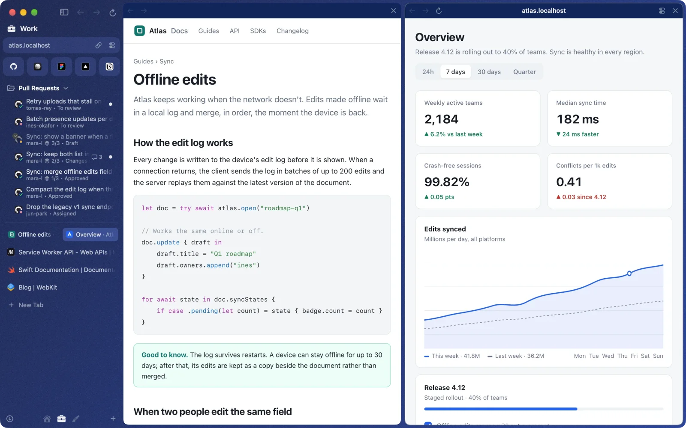

# Broadway

Broadway is a native macOS web browser built on WebKit, with spaces, a sidebar of tabs and pins, Chrome extensions, a built-in ad blocker, passwords and passkeys, and a `broadway` command that lets you, your scripts and coding agents drive it from a terminal.

<picture>
  <source media="(prefers-color-scheme: dark)" srcset=".github/broadway-dark.webp">
  
</picture>

**Just want the browser?** [Download Broadway](https://broadwaybrowser.com/download) for macOS 27 or later. It updates itself. Everything below is for building it from source.

Broadway began as a fork of [Search](https://github.com/driceroland/Search), a macOS browser by Office Commun, and is used under the MIT License. See [LICENSE](LICENSE) and [THIRD-PARTY-NOTICES.md](THIRD-PARTY-NOTICES.md).

## Status

Broadway is made by one person and is in its early versions. It is the browser its maintainer uses every day, and it changes quickly. Expect rough edges, settings that move, and a reply to your issue that can take a while.

## Requirements

- macOS 27 or later
- Xcode 27 or its command line tools (Swift 6.4)

## Build and run

```sh
./build.sh
open build/Broadway.app
```

`./build.sh` builds `build/Broadway.app` for this Mac's chip. `SEARCH_ARCH=x86_64 ./build.sh` builds for Intel into `build/intel/`. `SEARCH_DEV=1 ./build.sh` makes a dev build on a yellow icon, named after the branch, so it is never mistaken for an installed copy. `./build.sh release dmg` also makes `build/Broadway.dmg`.

A build shares its settings and data with any Broadway installed on the Mac, since the bundle id is the same. To try it without touching your own browser, open a test world instead:

```sh
./fresh.sh          # a fresh test world, as on a first launch
./fresh.sh again    # the same world as it was left
```

A test world has its own folder under Application Support, its own settings and its own website data.

### Signing

Without any setup a build is signed ad-hoc, which is enough to run it on the Mac that built it. To sign with your own certificates, copy [build.env.example](build.env.example) to `~/.config/broadway/build.env`, or anywhere `BROADWAY_BUILD_ENV` points, and fill it in:

| Key | What it is |
|---|---|
| `TEAM` | Your Apple Developer team id. A release is signed with the Developer ID Application certificate of this team, or an Apple Development one when there is none |
| `SIGN_IDENTITY` | A certificate to sign every build with, by name or hash, instead of looking one up |
| `STABLE_IDENTITY` | A certificate for everyday builds, so macOS keeps camera, microphone and other grants across rebuilds |
| `SIGNING_KEYCHAIN`, `SIGNING_KEYCHAIN_ACCOUNT`, `SIGNING_KEYCHAIN_SERVICE` | A separate keychain holding the release certificate, and the login keychain item with its password, unlocked before a release build |
| `NOTARY_PROFILE` | The `xcrun notarytool store-credentials` profile that `./build.sh release ship` notarises with |

Passkeys need a provisioning profile from Apple that grants the browser passkey entitlement. Put it beside `build.sh` as `Search.provisionprofile` and the build embeds it.

## Test

```sh
Tests/fast.sh
```

`Tests/fast.sh` builds and runs the Swift tests in parallel shards, in test worlds of their own. `--filter NAME` runs only the suites or tests that match. The suite also runs `Tests/copy_lint.py`, which checks the wording people read, and `Tests/public_tree.py`, which fails when a tracked file holds a home folder path, a real email address, a signing identity or team id, something shaped like a key, or the address of something that stays private, such as a deploy target, a cloud account id or a private document.

The `Tests/*.py` probes drive a real `build/Broadway.app` in a hidden test world, through `./bench`. Run `./build.sh` first and run one probe at a time, for example `python3 Tests/side_chrome.py`. `Tests/run-probes.py` runs them all in turn. `./bench help` lists what the bench can do, and `./bench-mcp` offers the same to a coding agent as an MCP server.

## The broadway command

`broadway` drives the browser from a terminal, for you, your scripts and coding agents. Set it up from Settings, or run `Broadway.app/Contents/Helpers/broadway setup`, then:

```sh
broadway "find the cheapest flight to Lisbon"
broadway open https://example.com
broadway snapshot
broadway click @e3
broadway read | head
```

`broadway help` lists every command, and `broadway guide` is the short version for agents. Add `--json` to any command for one stable envelope. See [docs/cli.md](docs/cli.md).

## Layout

| Path | What it holds |
|---|---|
| `Sources/Search/` | The app. The target keeps its upstream name, Search, and builds Broadway |
| `Sources/Search/Kit/` | The app's own controls and drawing |
| `Sources/BroadwayCLI/`, `Sources/broadway/` | The `broadway` command |
| `Tests/SearchTests/`, `Tests/BroadwayCLITests/` | The Swift tests |
| `Tests/*.py` | Probes that drive a built app, with their fixtures beside them |
| `Icon/`, `Installer/` | The app icon and the disk image window, drawn in Swift when the app is built |
| `Release/`, `release.sh` | Publishing a release and its update feed |
| `docs/` | How parts of the app work |
| `build.sh`, `sign.sh`, `fresh.sh`, `bench`, `bench-mcp` | Building, signing, test worlds and the bench |
| `.github/` | Issue forms, the pull request template and the pictures in this file |
| `Broadway.sdef` | The AppleScript dictionary |
| `Search.entitlements`, `Search.passkeys.entitlements` | What the app asks macOS for, without and with passkeys |

## Security

See [SECURITY.md](SECURITY.md). Report problems privately to support@broadwaybrowser.com.

## Contributing

Issues and pull requests are welcome. Read [CONTRIBUTING.md](CONTRIBUTING.md) first, and the [code of conduct](CODE_OF_CONDUCT.md). Security problems go to [SECURITY.md](SECURITY.md), not to an issue.

## Releases

Publishing a release is the maintainer's job. `./release.sh` uploads a notarised image and the signed update feed to broadwaybrowser.com and deploys the site, which lives in a separate repository that is not public. It needs that repository, the project's Cloudflare account and the Sparkle key that signs updates, so anywhere else it stops before doing anything. `./release.sh --help` explains every step.

What you can run is everything up to the image: `./build.sh release dmg` makes `build/Broadway.dmg`, signed ad-hoc or with your own certificates (see [Signing](#signing)). An everyday `./build.sh` build never looks for updates. A release build carries broadwaybrowser.com's feed and public key, so it replaces itself with the maintainer's next release. A fork that ships releases of its own sets `FEED` and `FEED_KEY` in `build.sh` to its own feed and key.

## License

The code is under the [MIT License](LICENSE), with two copyright lines, Office Commun's for Search and the maintainer's for Broadway. Bundled fonts and frameworks keep their own licences, listed in [THIRD-PARTY-NOTICES.md](THIRD-PARTY-NOTICES.md).

The licence covers the code. It gives no right to use the name Broadway, or its icon as a mark, for another app. If you ship a fork to other people, give it its own name and icon. See [TRADEMARKS.md](TRADEMARKS.md).
